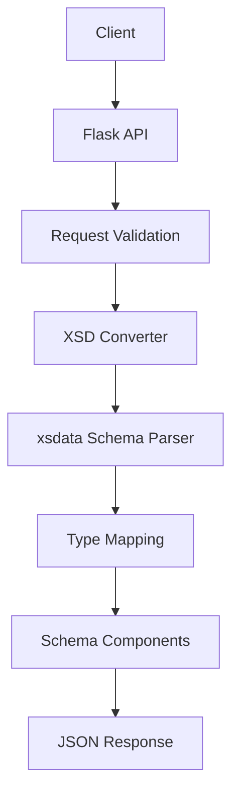

# Architecture

## Overview

The application converts supported XML Schema Definition (XSD)
structures into JSON-based schema components using Python and xsdata.

## Processing Flow

## Components

### Flask API

`src/xsd_schema_converter/flask_app.py`

Receives an XSD document through an HTTP POST request and returns
the conversion result as JSON.

### Schema Converter

`src/xsd_schema_converter/SchemaConverter.py`

Contains the conversion function and primitive type-mapping logic.

### Examples

The `examples/` directory contains a synthetic XSD document and its
expected output.

### Tests

The `tests/` directory contains checks for supported type mappings
and conversion of the example schema.

## Current Limitations

The converter supports only the XSD constructs implemented in its
current source code. Complex nested types, inline types, attributes,
choices, and other advanced constructs should not be assumed to work
without dedicated implementation and tests.

## Security

Only publish schemas and sample data that you are authorized to share.
Use synthetic examples rather than internal or customer-specific schemas.